# PCB Inspection System

Fotoğraf tabanlı, yapay zekâ destekli PCB kalite kontrol (AOI) sistemi. Kamera veya donanım entegrasyonu yoktur; kullanıcı bir PCB fotoğrafı yükler, sistem gerçek YOLO modelleriyle lehim ve komponent kusurlarını tespit eder, isteğe bağlı referans kartıyla karşılaştırma yapar ve gerekçeli bir kalite kararı üretir.

## Proje ne işe yarar?

Üretim hattında gözle kontrol edilen PCB'ler için tekrarlanabilir, izlenebilir bir dijital muayene akışı sağlar:

- **Tespit:** Gerçek YOLO26 ağırlıklarıyla 9 kusur sınıfını (lehim ve komponent) fotoğraf üzerinde bulur.
- **Karşılaştırma:** Referans kart / BOM ile SIFT + RANSAC hizalaması ve Hungarian eşleştirme kullanarak eksik, yanlış, kaymış ve fazla komponenti ayırt eder.
- **Karar:** Sınıf bazlı eşikler, kritik kusur kuralları ve referans bulgularıyla `PASS / FAIL / MANUAL REVIEW` kararı verir; her kararın gerekçesi kaydedilir.
- **Raporlama:** İşaretlenmiş görsel, JSON + PDF rapor ve SQLite geçmiş kaydı üretir.
- **İzlenebilirlik:** Mock ve gerçek motor sonuçları açıkça ayrılır; ölçüm dosyası yoksa metrikler "ölçülmedi" olarak gösterilir.

Amaçlar: tek kutu çizmek yerine uçtan uca AOI akışı kurmak, uydurma metrik/demo verisi kullanmamak, desteklenmeyen kusurları tespit edilmiş gibi göstermemek ve her sonucu kaynağıyla birlikte raporlamaktır.

Desteklenmeyen: `rotation_error` (komponent modeli açı üretmez), `open_joint` (model sınıfı yok), bilinmeyen anomali (anomaly detection modeli yok). `solder_void` RGB fotoğrafta lehim altını doğrulayamadığı için düşük güvenilirliktedir. Ayrıntılar: [`docs/MODELS.md`](docs/MODELS.md).

## PCB Analizi Fotoğrafları

Aşağıdaki görsellerin tamamı gerçek test split'indeki PCB fotoğrafları kullanılarak, gerçek modelle, tarayıcıdan yapılan analizlerin ekran görüntüleridir. Mock motor kullanılmamıştır. Her görselin altında hangi sınıfın, hangi güvenle tespit edildiği ve kararın ne olduğu açıklanır.

### Yetersiz Lehim — `insufficient_solder`

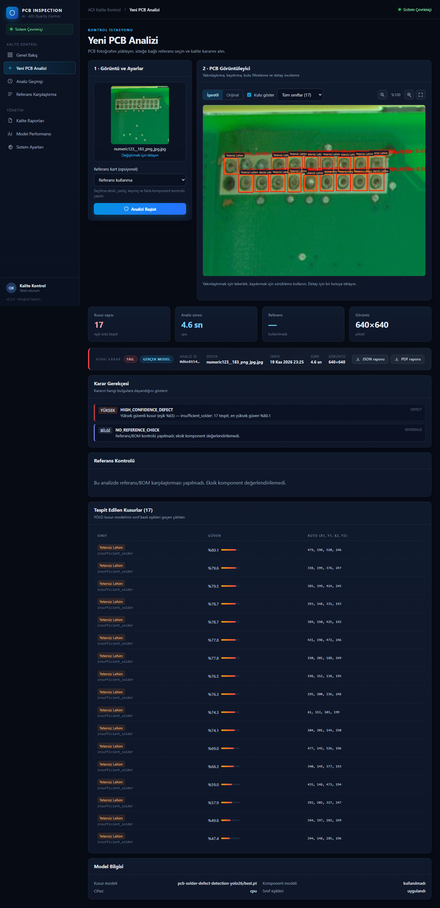

Gerçek test görseli `numeric123__183_png_jpg.jpg` analiz edildi. model bu sınıfta 17 kutu tespit etti; en yüksek güven %80.2 (sınıf eşiği %29.7). Toplam kusur sayısı 17, karar **FAIL**. Analiz ID: `0d6e8154-fd84-4497-852d-8cc32caecbdd`.

### Fazla Lehim — `excess_solder`

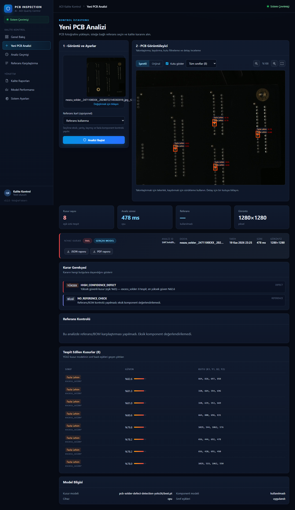

Gerçek test görseli `neazu_solder__2471100EXX__20240722145302018_jpg__t2880_960.jpg` analiz edildi. 8 fazla lehim kutusu tespit edildi; en yüksek güven %82.6 (sınıf eşiği %34.9). Karar **FAIL**. Analiz ID: `10f3e6d9-f56e-4408-b137-9e06a78141db`.

### Lehim Köprüsü — `solder_bridge`

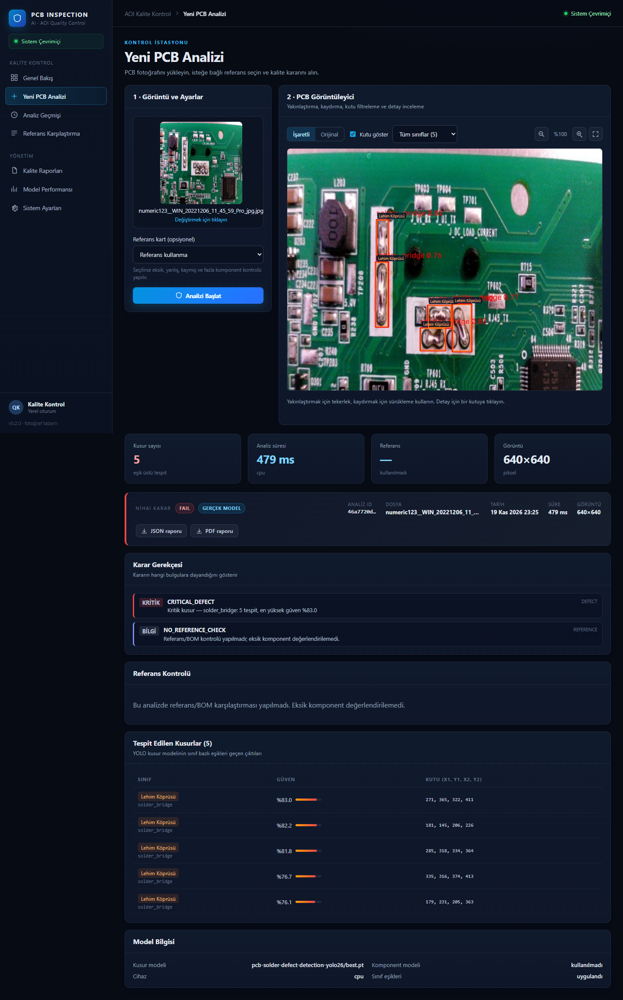

Gerçek test görseli `numeric123__WIN_20221206_11_45_59_Pro_jpg.jpg` analiz edildi. 5 köprü kutusu tespit edildi; en yüksek güven %83.0 (sınıf eşiği %41.7). Bu sınıf kritik kusur sayıldığı için karar **FAIL**. Analiz ID: `46a7720d-e7a5-4bde-8e9f-23767af4ddbe`.

### Lehim Boşluğu — `solder_void`

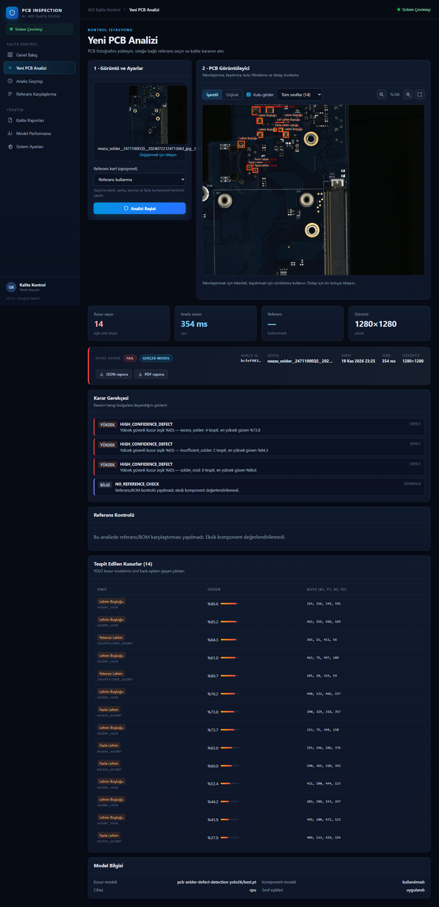

Gerçek test görseli `neazu_solder__2471100EQ5__20240722124713063_jpg__t1920_960.jpg` analiz edildi. 8 `solder_void` kutusu tespit edildi; en yüksek güven %86.6 (sınıf eşiği %24.9), toplam kusur 14, karar **FAIL**. **Önemli sınır:** RGB fotoğrafta lehim altı void doğrulanamaz; bu sınıfın sonucu düşük güvenilirliktedir ve tek başına kalite kararı için kullanılmamalıdır. Analiz ID: `bcfef483-5e32-4a57-9ada-cf1bbe4c6edc`.

### Eksik Komponent — `missing_component`

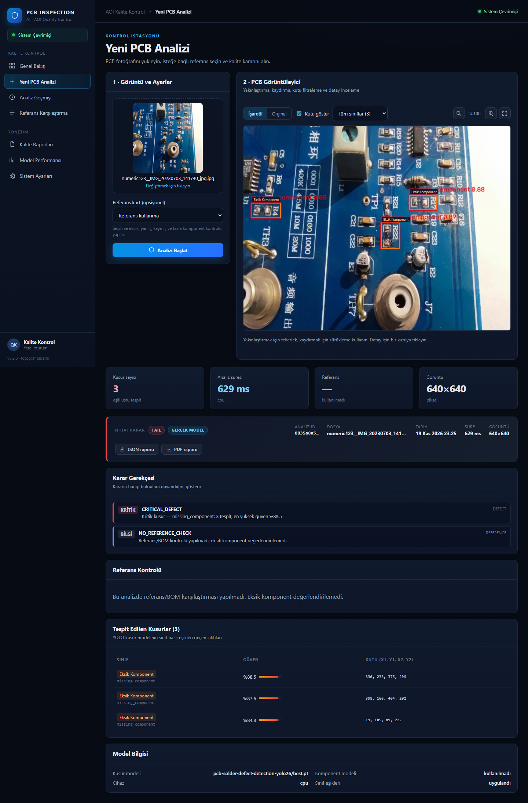

Gerçek test görseli `numeric123__IMG_20230703_141740_jpg.jpg` analiz edildi. 3 eksik komponent kutusu tespit edildi; en yüksek güven %88.5 (sınıf eşiği %38.1). Kritik kusur olduğu için karar **FAIL**. Bu görsel, referans/BOM karşılaştırması olmadan doğrudan kusur modeli tarafından üretilmiştir. Analiz ID: `8835a8a5-e7d5-4bc3-b25c-168a83baf854`.

### Kaymış Komponent — `shifted_component`

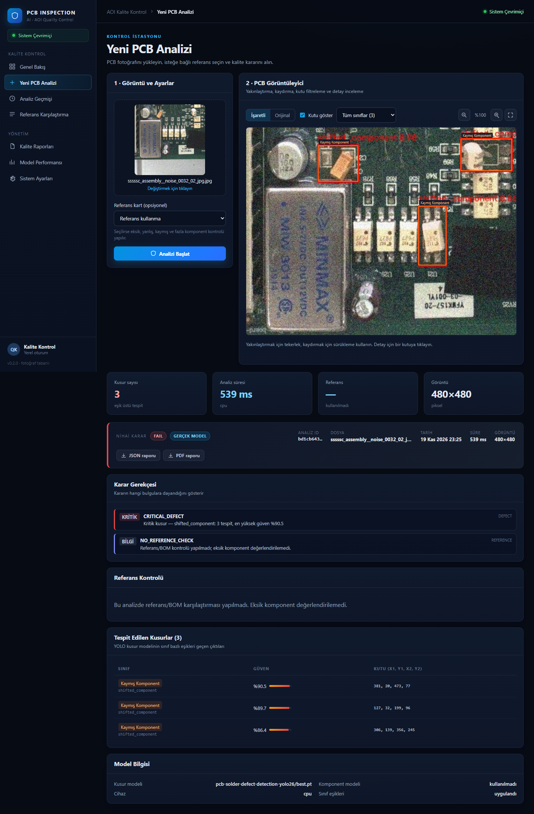

Gerçek test görseli `sssssc_assembly__noise_0032_02_jpg.jpg` analiz edildi. 3 kaymış komponent kutusu tespit edildi; en yüksek güven %90.5 (sınıf eşiği %38.9). Kritik kusur olduğu için karar **FAIL**. Analiz ID: `bd1cb643-596a-46e0-8cc3-d0f5e93f7bcb`.

### Yanık / Isı Hasarı — `burn`

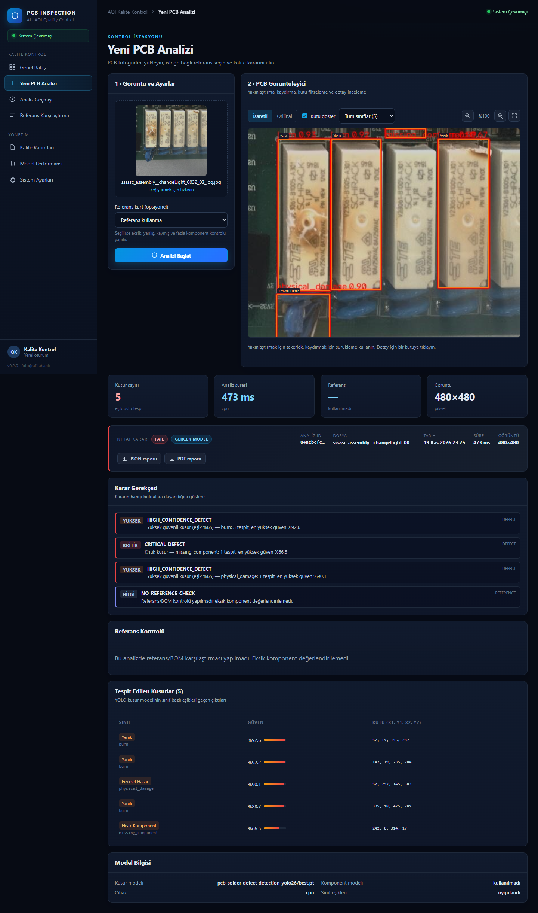

Gerçek test görseli `sssssc_assembly__changeLight_0032_03_jpg.jpg` analiz edildi. 3 yanık kutusu tespit edildi; en yüksek güven %92.6 (sınıf eşiği %22.4), toplam kusur 5, karar **FAIL**. Analiz ID: `84aebcfc-27f1-441a-afd4-b3c0cc6768c0`.

### Fiziksel Hasar — `physical_damage`

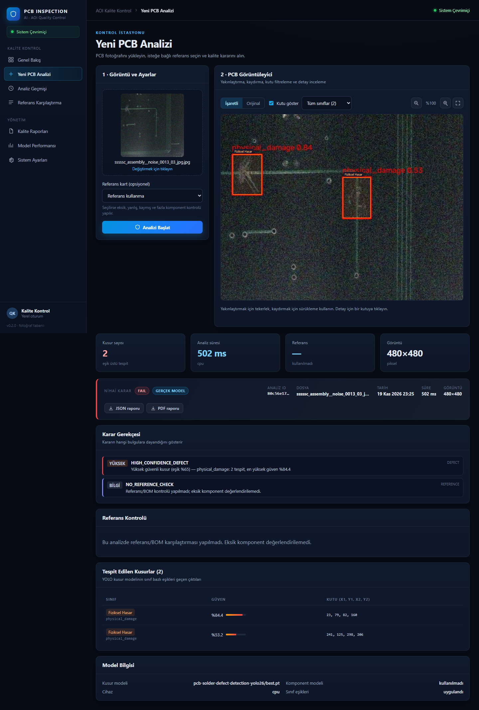

Gerçek test görseli `sssssc_assembly__noise_0013_03_jpg.jpg` analiz edildi. 2 fiziksel hasar kutusu tespit edildi; en yüksek güven %84.5 (sınıf eşiği %21.4), karar **FAIL**. Analiz ID: `80c56e17-db7b-4565-ba37-7774e36eca68`.

### Oksitlenme — `oxidation`

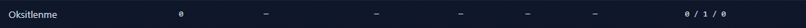

Bu sınıf için gerçek bir tespit örneği **yoktur**: test split'inde `oxidation` etiketli 0 kutu bulunur. Bu nedenle uydurma bir analiz görseli eklenmemiştir; yukarıdaki görsel Model Performansı sayfasındaki gerçek ölçüm satırıdır (`destek 0`, precision/recall/F1/AP değerleri `—`, TP/FP/FN `0 / 1 / 0`). Sınıf modelde tanımlıdır ancak bu test verisiyle güvenilir biçimde ölçülememiştir.

## Sayfa Sayfa Arayüz Görüntüleri

Aşağıdaki ekran görüntüleri uygulamanın 7 sayfasını ve analiz durumlarını kapsar. Hepsi gerçek API verisiyle, 1440×1000 tarayıcı penceresinde tam sayfa olarak alınmıştır.

### Genel Bakış

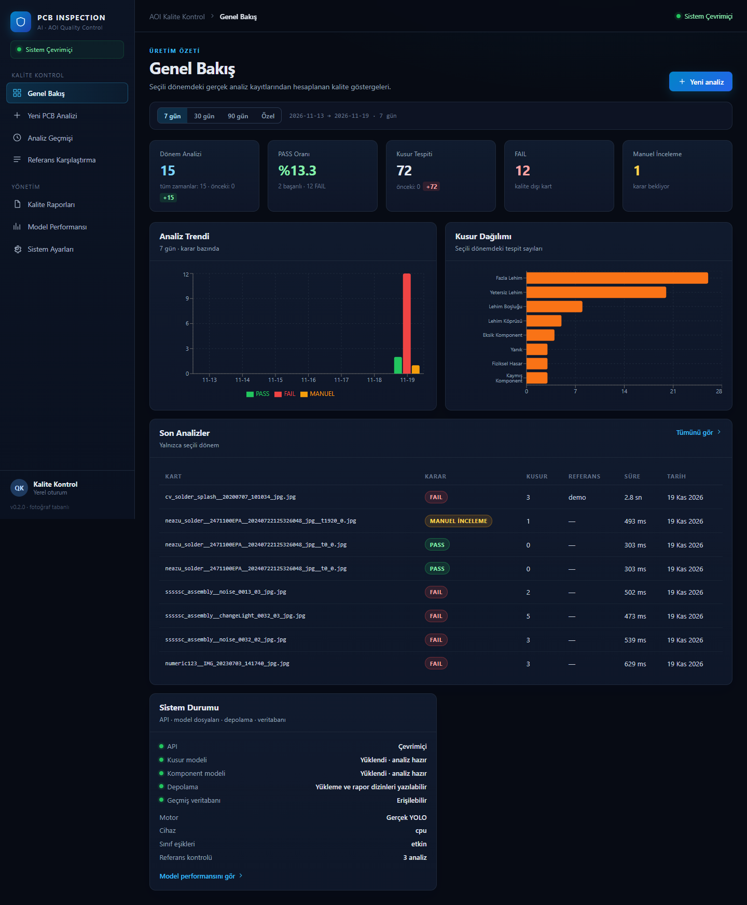

Dashboard 7/30/90 gün ve özel tarih filtrelerini, gerçek API'den gelen analiz/kusur değişimini, Türkçe kusur etiketlerini ve son analizleri gösterir. API/model/depolama/DB durumları yine gerçek `/api/v1/status` yanıtından okunur.

### Yeni PCB Analizi — boş durum

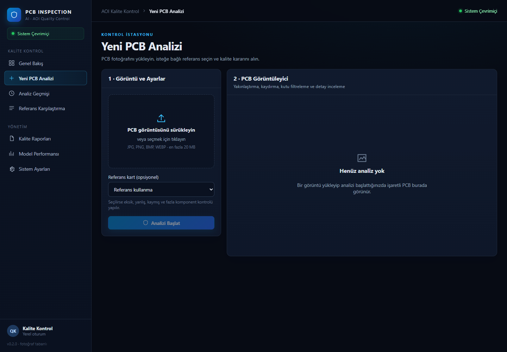

Görsel yükleme alanı, isteğe bağlı referans seçici ve "Analizi Başlat" butonu görülür. Dosya seçilmeden buton devre dışıdır.

### Yeni PCB Analizi — yükleme durumu

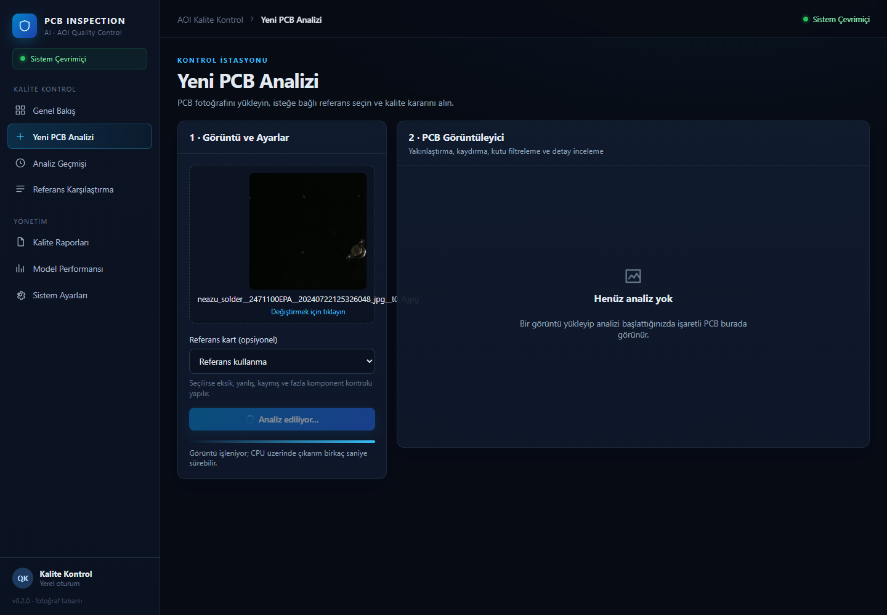

CPU üzerinde çıkarım sürerken "Analiz ediliyor…" durumu gösterilir. Bu sırada tespit, referans karşılaştırması, karar ve rapor üretimi arka planda çalışır.

### Yeni PCB Analizi — PASS durumu

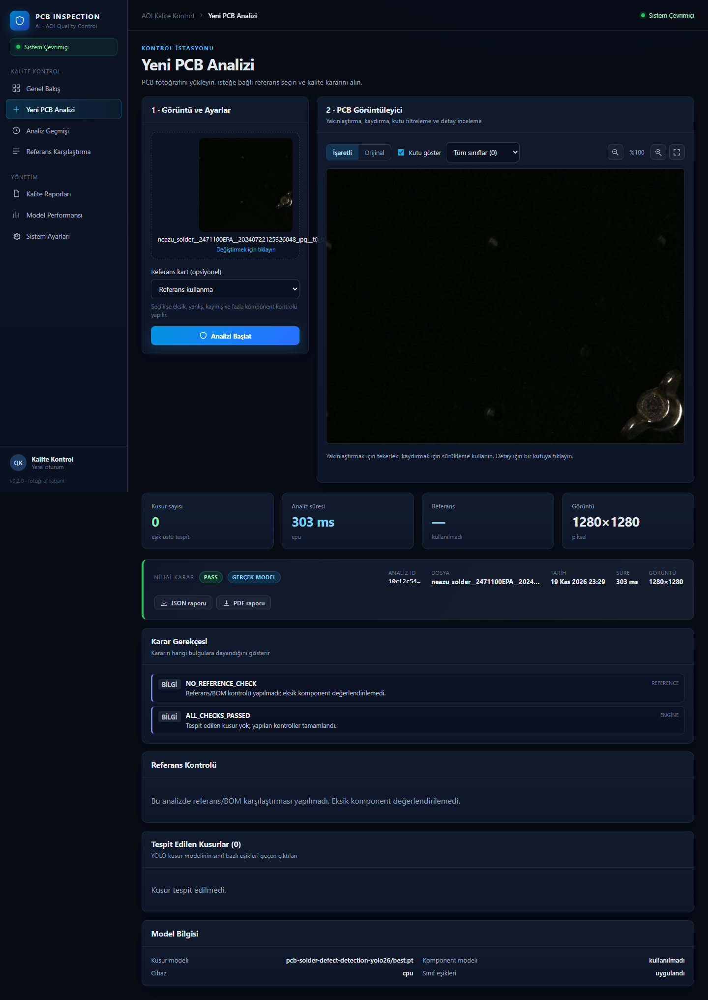

Eşik üstü kusur tespit edilmeyen gerçek bir test görseli için karar **PASS** verilmiştir. Gerekçe `ALL_CHECKS_PASSED` olarak kaydedilmiştir; referans kullanılmadığı için `NO_REFERENCE_CHECK` bilgi gerekçesi de görünür.

### Yeni PCB Analizi — MANUAL REVIEW durumu

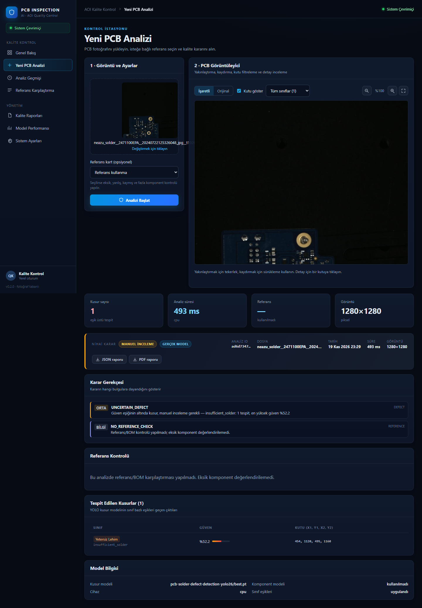

Düşük güvenli bir `insufficient_solder` tespiti (%52.2) için otomatik FAIL/PASS verilmemiş, karar **MANUAL REVIEW** olmuştur. Gerekçe `UNCERTAIN_DEFECT` / `LOW_CONFIDENCE_DEFECT` mantığıyla üretilir; düşük güvenli tespit PASS'e dönüşmez.

### Yeni PCB Analizi — referanslı analiz

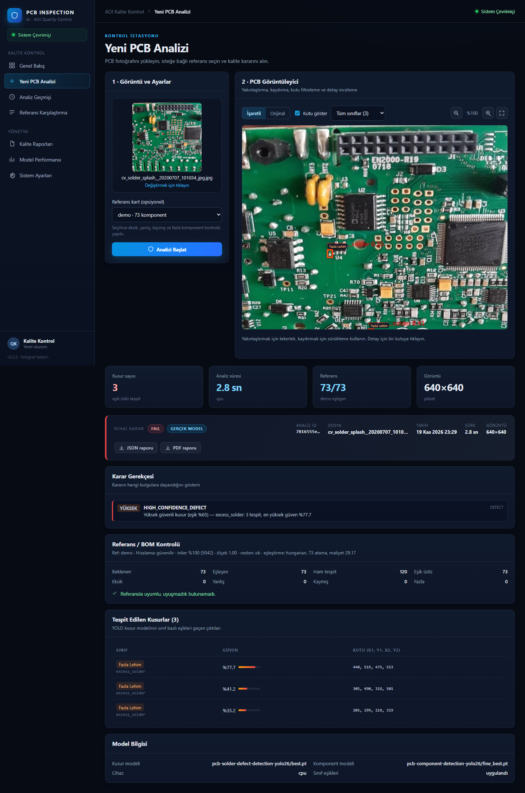

`demo` referansı seçilerek yapılan analizde hizalama güvenilir (inlier %100), Hungarian eşleştirmede 73/73 komponent eşleşmiştir; eksik/yanlış/kaymış/fazla komponent bulunmamıştır. Kusur tespitleri nedeniyle nihai karar **FAIL**'dir.

### Analiz Geçmişi

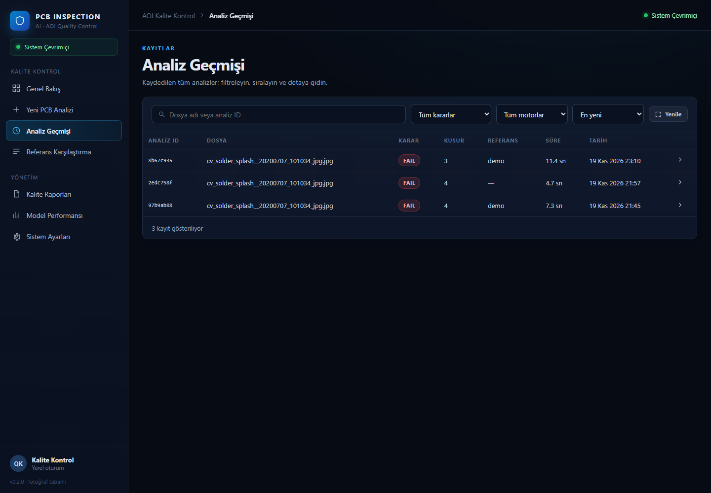

Gerçek SQLite kayıtları listelenir; dosya adı/analiz ID araması, karar ve motor filtreleri, sıralama ve sayfalama çalışır. Satıra tıklamak ilgili analizin sonuç panelini açar.

### Referans Karşılaştırma

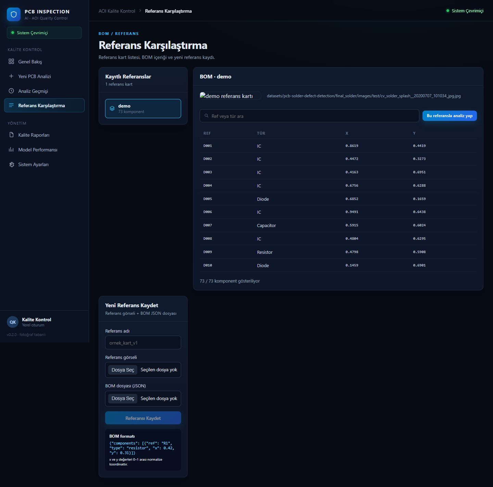

Mevcut referans kartları ve komponent listesi görüntülenir; arama, referansı analizde kullanma ve yeni referans oluşturma formu bulunur. Referans eşleştirme ayrıntıları [`docs/REFERENCE.md`](docs/REFERENCE.md) içindedir.

### Kalite Raporları

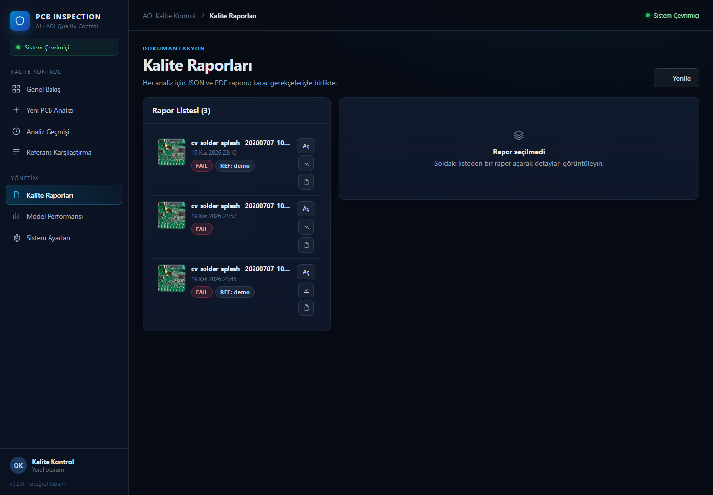

Geçmiş analizlerin JSON ve PDF raporlarına gerçek dosya yolları üzerinden erişilir. Raporlar analiz anında üretilir; demo raporu yoktur.

### Model Performansı

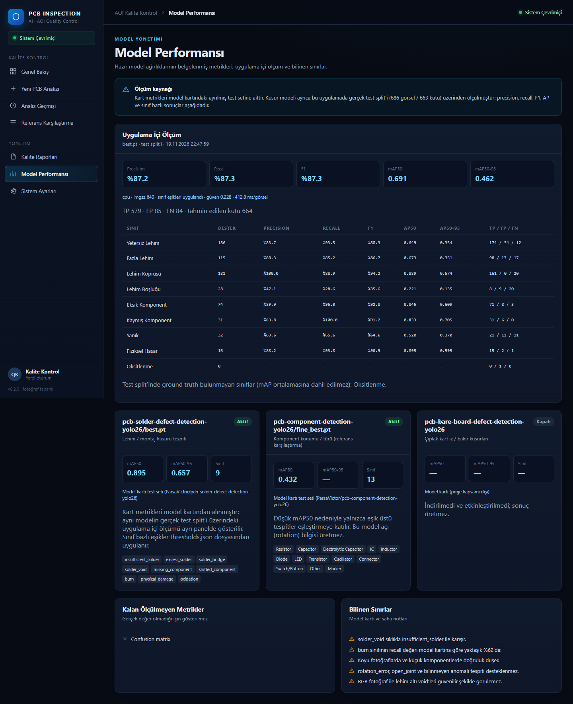

Model kartı metrikleri ile uygulama içi gerçek ölçüm ayrı panellerde gösterilir. Ölçüm 686 görsel / 663 kutu üzerinde yapılmıştır: precision %87.2, recall %87.3, F1 %87.3, mAP50 0.691, mAP50-95 0.462. `oxidation` satırında ground truth olmadığı için metrikler `—` gösterilir.

### Sistem Ayarları

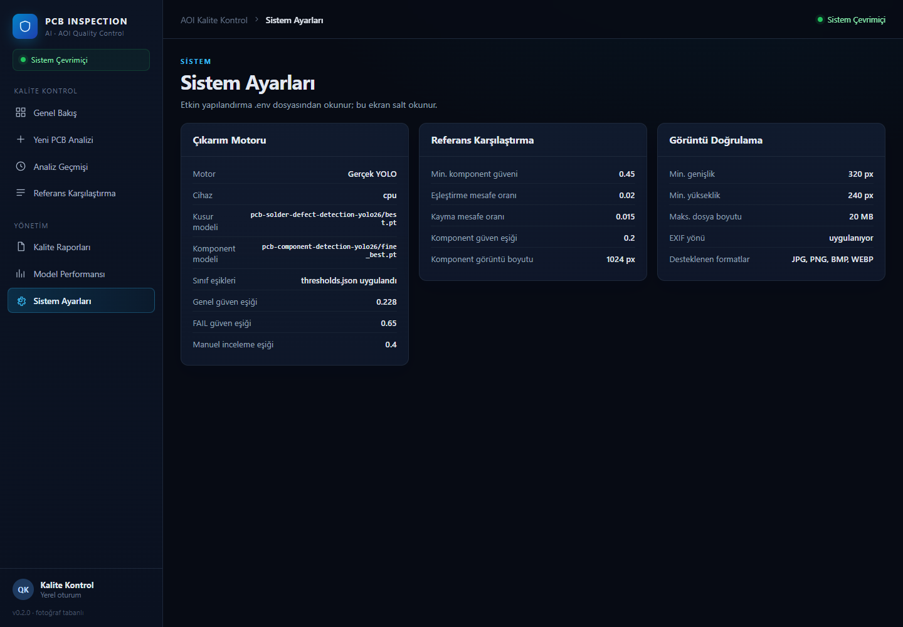

`.env` dosyasından okunan etkin yapılandırma salt okunur olarak gösterilir: gerçek YOLO motoru, CPU, model yolları, genel güven eşiği 0.228, FAIL eşiği 0.65, manuel inceleme eşiği 0.4 ve referans eşleştirme eşikleri.

## Testler ve doğrulama kanıtları

Ekran görüntülerinin yanında otomatik kontroller de çalıştırıldı:

- `.\.venv\Scripts\python.exe -m pytest backend\tests -q` → **78 passed**.
- `npm.cmd run build` → başarılı; yalnızca JS paketinin 500 kB üzerinde olması uyarısı var.
- Tüm sayfalar ve etkileşimler (dashboard filtreleri, geçmiş arama/filtre/sıralama, rapor bağlantıları, referans seçimi, model/ayar sayfaları) headless Edge ile gezildi.
- **500 hatası bulunamadı:** 72 istek `200`, beklenen doğrulama/geçersiz kimlik yanıtları `400 / 404 / 422` olarak döndü. Genel Bakış'ta görülen tek console hatası eksik `favicon.ico` 404'üydü; `frontend/index.html` içine gömülü SVG favicon eklenerek düzeltildi.
- Ayrıca `days=0`, `days=99999`, geçersiz tarih aralığı, `limit=0`, çok büyük `offset`, geçersiz filtre değerleri ve var olmayan analiz/referans ID'leri doğrudan API'ye soruldu; hiçbiri 500 üretmedi.
- Ekran görüntüsü oturumlarının ham sonuçları [`docs/screenshots/report.json`](docs/screenshots/report.json) ve [`docs/screenshots/report-extra.json`](docs/screenshots/report-extra.json) dosyalarındadır; her sayfa/sınıf için console ve HTTP hata listeleri kayıtlıdır.

## Teknoloji yığını

- **AI / CV:** Python, PyTorch (CPU), Ultralytics YOLO26, OpenCV (SIFT + RANSAC hizalama)
- **Backend:** FastAPI, Pydantic, `sqlite3` (stdlib)
- **Frontend:** React + TypeScript, Vite, Recharts, hash tabanlı router
- **Loglama:** Tek satırlık JSON, `request_id` korelasyonu, `LOG_LEVEL`
- **Veri:** Yerel dosya sistemi + `data/inspections.db` (çok kullanıcılı aşamada PostgreSQL)

Yerel model eğitimi yoktur; yalnızca hazır `.pt` ağırlıkları kullanılır.

## Aşamalar

- **Aşama 1 — güvenilirlik ve karar motoru:** gerçek YOLO çıkarımı, sınıf eşikleri, referans eşleştirme, gerekçeli karar, mock/gerçek ayrımı, görüntü doğrulama, kilitli model yükleyici, hata şeması, testler. ✅
- **Aşama 2 — arayüz:** Industrial Dark tema, 7 sayfalık hash router, zoom/pan görüntüleyici, geçmiş/raporlar, gerçek metriklerle model ekranı. ✅
- **Aşama 3 — operasyonel izlenebilirlik:** ortak API hata gövdesi, `X-Request-ID`, yapılandırılmış JSON log. ✅
- **Aşama 4 — AOI Engine 2.0:** güvenli SIFT/RANSAC hizalaması, global komponent eşleştirme (Hungarian), izlenebilir fark analizi, tiling, gerçek test split'iyle uygulama içi değerlendirme, sınıf bazlı metrikler ve karar eşiklerinin izlenebilirliği. ✅
- **Sonraki:** çok kullanıcılı veri katmanı. Kamera/donanım, lokal model eğitimi, rotasyon/konum analizi ve containerization bu sürümde yoktur.

## Veri setleri ve plan

Araştırma ve seçim gerekçesi: [`docs/DATASETS.md`](docs/DATASETS.md)  
Geliştirme planı: [`docs/ROADMAP.md`](docs/ROADMAP.md)  
Teknik bulgular ve borç kayıtları: [`docs/AUDIT.md`](docs/AUDIT.md), [`docs/TECHNICAL_DEBT.md`](docs/TECHNICAL_DEBT.md)

## Yerel Kurulum

Python 3.11+ ve Node.js 20+ önerilir.

```powershell
# Backend (proje kökünden)
python -m venv .venv
.\.venv\Scripts\Activate.ps1
pip install -r backend\requirements-dev.txt
uvicorn backend.app.main:app --reload --port 8000
```

```powershell
# Frontend (ayrı terminal)
cd frontend
npm.cmd install
npm.cmd run dev
```

Arayüz: http://localhost:5173 · API docs: http://localhost:8000/docs

Üretim derlemesi:

```powershell
cd frontend
npm.cmd run build
```

Testler:

```powershell
.\.venv\Scripts\python.exe -m pytest backend\tests -q
```

Uygulama içi değerlendirme (gerçek model + gerçek test split'i; mock motor aktifse reddedilir):

```powershell
.\.venv\Scripts\python.exe -m backend.scripts.evaluate_model --split test
# hızlı kontrol: --limit 5
```

Sonuç `data/evaluation/solder-defect-test.json` dosyasına yazılır (gitignored). `/api/v1/models` yalnızca gerçek bir ölçüm dosyası varsa `measured_in_app=true` döner ve sınıf bazlı sonuçları model kartı metriklerinden ayrı bir panelde gösterir; dosya yoksa "ölçülmedi" olarak kalır.

## API ve hata şeması

Ana endpoint'ler: `POST /api/v1/uploads`, `POST /api/v1/inspections`, `GET /api/v1/history`, `GET /api/v1/history/overview`, `GET /api/v1/history/{id}`, `GET /api/v1/references`, `GET /api/v1/models`, `GET /api/v1/settings`, `GET /api/v1/status`.

Tüm hata yanıtları aynı gövdeyi kullanır ve `X-Request-ID` başlığı taşır:

```json
{
  "error": "bad_request",
  "detail": "Dosya geçerli bir görüntü değil",
  "request_id": "verify-i3-001"
}
```

İstekte `X-Request-ID` gönderilirse aynı değer yansıtılır; aksi halde sunucu UUID üretir. Her istek ve analiz tek satırlık JSON olarak loglanır; `request_id` alanı logları istekle iliştirir. Log seviyesi `.env` içindeki `LOG_LEVEL` ile ayarlanır (varsayılan `INFO`). Önemli olaylar: `request_completed`, `api_error`, `validation_error`, `inspection_completed`.

Hazır modeli indir (lokal eğitim gerekmez):

```powershell
.\.venv\Scripts\python.exe -m backend.training.download_model
Copy-Item .env.example .env
```

`.env` içeriği hazır modeli ve sınıf bazlı eşikleri gösterir. GPU varsa `DEVICE=0`, yoksa `DEVICE=cpu` kullanın. Ayrıntılar: [`docs/MODELS.md`](docs/MODELS.md).

Model dosyası yoksa sistem otomatik olarak mock detector ile çalışır; akış uçtan uca test edilebilir, ancak mock motor asla `PASS` kararı vermez ve sonuç `MANUAL_REVIEW` olarak işaretlenir. Veri setleri, model dosyaları, `data/` altındaki yüklemeler/raporlar/SQLite veritabanı `.gitignore` ile repo dışında tutulur.
